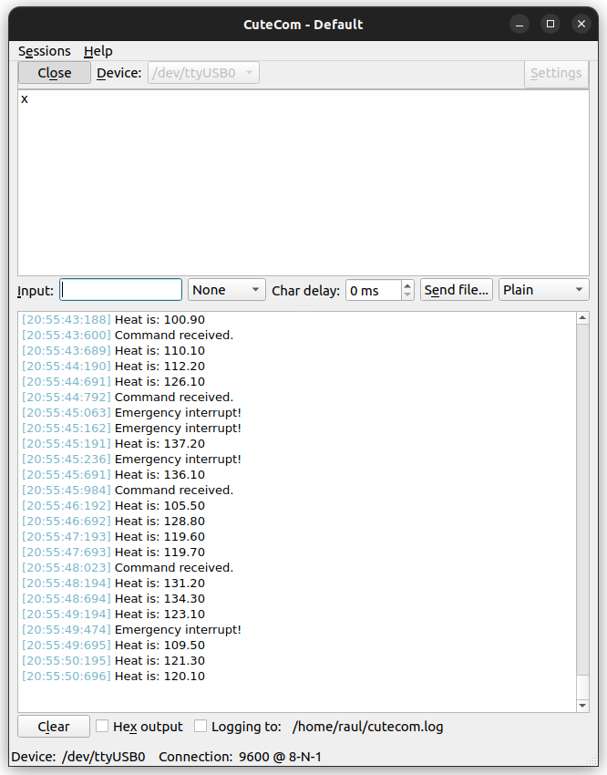

# FreeRTOS UART Sync Engine on STM32F407G-DISC1

An event-driven FreeRTOS project on the STM32F407G Discovery board that demonstrates **task synchronization with semaphores, a software timer, and a mutex-protected UART**. Three tasks of different priorities are woken by a timer, a UART interrupt, and a hardware button interrupt, and all of them share a single serial port safely.

## Project Architecture & Features

```
┌─────────────────────────┐  Binary Semaphore   ┌────────────────────────┐
│ Software Timer (500 ms) │────────────────────>│ Task1: Sensor (Prio 1) │──┐
└─────────────────────────┘                     └────────────────────────┘  │
                                                                            │
┌─────────────────────────┐  Counting Semaphore ┌────────────────────────┐  │  Mutex   ┌───────────────┐
│ UART RX Interrupt       │────────────────────>│ Task2: Command (Prio 2)│──┼─────────>│ UART Terminal │
└─────────────────────────┘                     └────────────────────────┘  │ (guard)  │  (9600 Baud)  │
                                                                            │          └───────────────┘
┌─────────────────────────┐  Binary Semaphore   ┌────────────────────────┐  │
│ Button EXTI (PA0)       │────────────────────>│ Task3: Emergency(Prio 3)│─┘
└─────────────────────────┘                     └────────────────────────┘
```

### Task Breakdown & Priorities

1. **Sensor Task (Priority 1, every 500 ms):**
   - Woken by an auto-reload software timer through a binary semaphore.
   - Generates a simulated temperature value (80 - 120) using the hardware RNG and prints `Heat is: <value>`.
   - Toggles the Blue LED (PD15).

2. **Telemetry / Command Task (Priority 2):**
   - Woken by the UART receive interrupt through a counting semaphore (one count per received byte).
   - Prints `Command received.` and toggles the Green LED (PD12).

3. **Emergency Task (Priority 3):**
   - Woken by the user button (PA0) EXTI interrupt through a binary semaphore.
   - Prints `Emergency interrupt!` and toggles the Red LED (PD14).
   - Button presses are debounced in the ISR with a 50 ms window.

### Synchronization Primitives Used

| Primitive | Purpose |
|---|---|
| Software timer (auto-reload) | Generates the 500 ms sensor period |
| Binary semaphore (timer → Task1) | Signals the sensor task |
| Counting semaphore (UART ISR → Task2) | Counts received bytes so none are lost |
| Binary semaphore (button ISR → Task3) | Signals the emergency event |
| Mutex | Protects `huart` so tasks never transmit at the same time |

## Key Technical Highlights & Challenges Overcome

- **ISR vs. task API:** `xSemaphoreGiveFromISR` is used inside interrupt callbacks, while tasks use the blocking `xSemaphoreTake`. An early version called `xSemaphoreTakeFromISR` inside tasks; it never blocks, so the highest-priority task spun forever and starved the timer and lower-priority tasks.
- **Shared UART protection:** Three tasks print to the same UART. Without protection, a higher-priority task preempting a transmission gets `HAL_BUSY` and its message is silently lost. A mutex wrapper (`uart_print`) serializes access, and priority inheritance prevents priority inversion.
- **Button debounce:** The mechanical bounce of PA0 produced several interrupts per press. The EXTI callback ignores events within 50 ms of the last accepted one.
- **Interrupt priorities:** EXTI and USART interrupt priorities are kept numerically at or above `configMAX_SYSCALL_INTERRUPT_PRIORITY`, so FreeRTOS `FromISR` calls are safe.
- **Serial debugging:** Garbled or missing output was finally traced to swapped RX/TX wires; verifying the UART in isolation (without the RTOS) made this easy to separate from RTOS issues.

## Pinout Configuration

| Peripheral | STM32 Pin | Function |
|---|---|---|
| UART TX | `<PIN>` (`<USARTx>`) | Data to host / USB-TTL RX |
| UART RX | `<PIN>` (`<USARTx>`) | Data from host / USB-TTL TX |
| User Button | PA0 | Emergency interrupt (rising edge) |
| Green LED | PD12 | Command task activity |
| Orange LED | PD13 | Unused |
| Red LED | PD14 | Emergency task activity |
| Blue LED | PD15 | Sensor task activity |

Connect TX to the adapter's RX and RX to the adapter's TX (crossed), and share GND. Use a 3.3 V adapter.

## Getting Started & Requirements

- **IDE:** STM32CubeIDE
- **RTOS:** FreeRTOS (native API)
- **Hardware:** STM32F407G-DISC1, USB-to-TTL serial adapter

1. Clone the repository:
   ```bash
   git clone https://github.com/Raul-dev00/FreeRTOS-UART-Sync-Engine.git
   ```
2. Open the project in STM32CubeIDE.
3. Build and flash it to the board.
4. Open a serial terminal (e.g. Cutecom, PuTTY) at **9600 baud, 8N1, no flow control**.
5. Expected behavior:
   - `Heat is: <value>` every 500 ms
   - Press the blue button for `Emergency interrupt!`
   - Send any character for `Command received.`

## Example Output


